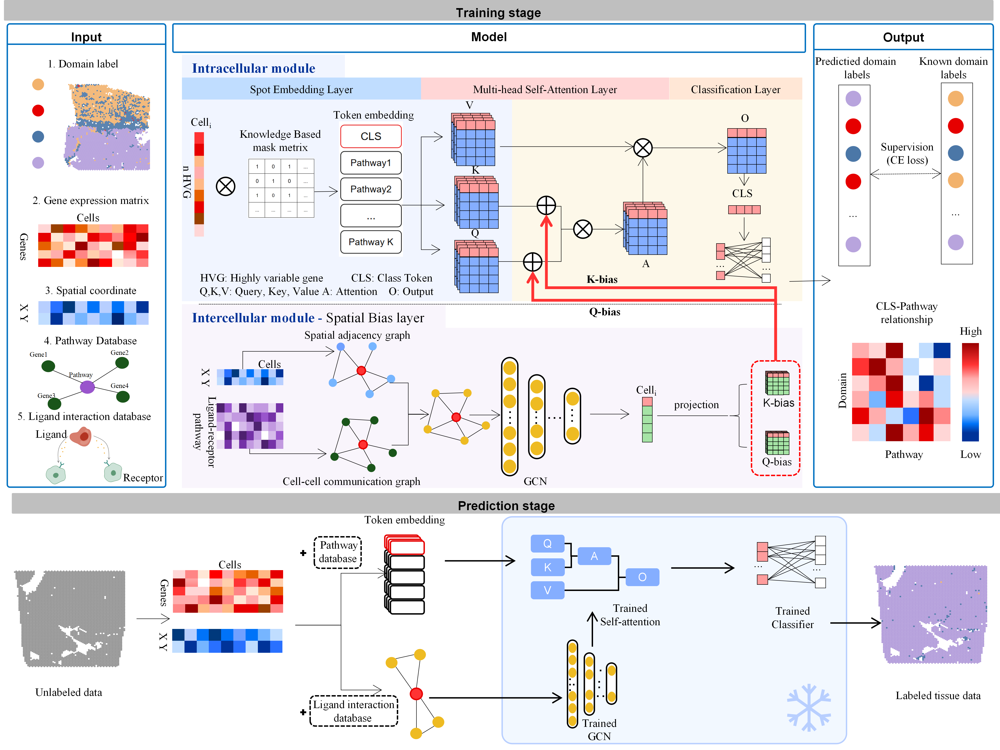

# K-SPADA

**Knowledge-guided spatial domain annotation with pathway and spatial context**

<p align="center">
  
</p>

K-SPADA is a supervised framework for **spatial domain annotation**. It learns from labeled reference samples and predicts spatial domain labels in query tissue samples.

The model combines **pathway-informed expression representations** with **spatial graphs and ligand-receptor-informed similarity graphs**. Gene-to-pathway masks define expression tokens, while graph convolutional representations provide spatial context to the queries and keys of Transformer attention.

The workflow includes:

- 🧬 Data preparation, pathway scoring, and ligand-receptor-informed similarity graph construction.
- 📍 Model training and reference-to-query annotation.
- 🔬 Spatial comparison of known and predicted labels, with PNG, PDF, and SVG export.

## 📚 Tutorials

Four step-by-step notebooks are available in [tutorials/](./tutorials/):

| Tutorial | Description | Main outputs |
| --- | --- | --- |
| [01 · Data preparation](./tutorials/01_data_preparation.ipynb) | Validate AnnData fields, split reference and query samples, normalize expression, and build pathway features and ligand-receptor-informed similarity graphs. | Prepared reference, query, and training/validation graph files. |
| [02 · Model training](./tutorials/02_model_training.ipynb) | Validate the prepared graph and train K-SPADA with explicit model parameters. | Model checkpoint, pathway mask, and label dictionary. |
| [03 · Prediction and visualization](./tutorials/03_prediction_and_visualization.ipynb) | Load the trained model, annotate a query sample, and plot spatial labels. | Prediction AnnData and spatial figures. |
| [04 · Quantile binning](./tutorials/04_binning_data_preparation.ipynb) | Preserve zero expression and map nonzero values to quantile bins within each cell. | Binned AnnData with integer values from 0 to 7. |

Run **01 → 02 → 03** for the annotation workflow. Tutorial **04** is an independent preprocessing example; its output is not an input to the supplied 01–03 workflow.

Open the notebooks with `tutorials/` as the working directory. Each notebook defines the repository root as `Path("..").resolve()`. Set the input paths and sample identifiers in the first code cell before running on your own data.

The saved outputs in tutorials 02–04 include training progress, predictions, spatial figures, and preprocessing checks.

## ⚙️ Installation

The tutorial environment uses **Python 3.8**, **PyTorch 2.1.1**, and **CUDA 11.8**. A CUDA-enabled GPU is required for the training notebook; the current prediction implementation runs on CPU.

```bash
git clone https://github.com/XiangyuLi-Lab/K-SPADA.git
cd K-SPADA

conda create -n KSPADA_env python=3.8 -y
conda activate KSPADA_env

python -m pip install -r requirements.txt
python -m pip install torch-scatter==2.1.2 torch-sparse==0.6.18 torch-cluster==1.6.2 \
    -f https://data.pyg.org/whl/torch-2.1.0+cu118.html
python -m pip install -e . --no-deps --no-build-isolation

python -m ipykernel install --user --name kspada --display-name "Python (KSPADA_env)"
```

The graph-extension wheels above match the pinned PyTorch/CUDA configuration. Core Python dependencies are listed in [requirements.txt](./requirements.txt).

Select **Python (KSPADA_env)** in your Jupyter interface or notebook editor, then open the [tutorials](./tutorials/).

## 📦 Datasets

The notebooks use AnnData files (`.h5ad`) with the following fields:

| Field | Description |
| --- | --- |
| `adata.X` | Expression matrix with cells or spots as rows and genes as columns. |
| `adata.var_names` | Gene identifiers compatible with the selected pathway resource. |
| `adata.obs["x"]`, `adata.obs["y"]` | Spatial coordinates. |
| `adata.obs["batch"]` | Sample identifiers used to define training, validation, and query splits. |
| `adata.obs["Celltype"]` | Reference annotation labels; also used for the ground-truth panel in the example visualization. |

The supplied example uses the liver cancer input `all_hvg_3000.h5ad`, with **3,000 genes** and the following sample configuration:

- **Training:** samples 4–15.
- **Validation:** sample 16.
- **Query preparation:** samples 17–21; tutorial 03 predicts sample 17.

Input datasets are stored separately from the source code. Update `DATA_DIR` and the input file paths to match your local data. Before prediction, query genes must match the training genes in both name and order. Keep the embedding dimension, Transformer depth, and attention-head count consistent with the trained checkpoint.

## 📂 Output files

The tutorials write their results beneath `outputs/` in the repository root:

```text
outputs/
├── liver_cancer_data_preparation/   # Reference, query, and ligand-receptor-informed similarity graph files
├── model_training/
│   └── example_model/
│       ├── model-9.pth             # Checkpoint after 10 training epochs
│       ├── mask.npy                # Gene-to-pathway mask
│       ├── pathway.csv             # Pathway token names
│       └── label_dictionary.csv    # Training label mapping
├── prediction/
│   ├── query_prediction.h5ad
│   ├── query_prediction_spatial.png
│   ├── query_prediction_spatial.pdf
│   └── query_prediction_spatial.svg
└── binning/
    └── binned_data.h5ad
```

Predicted labels and confidence scores are stored in `adata.obs["Prediction"]` and `adata.obs["Probability"]` in the prediction file.

## ✉️ Contact

For questions and bug reports, please open an issue on [GitHub Issues](https://github.com/XiangyuLi-Lab/K-SPADA/issues).
